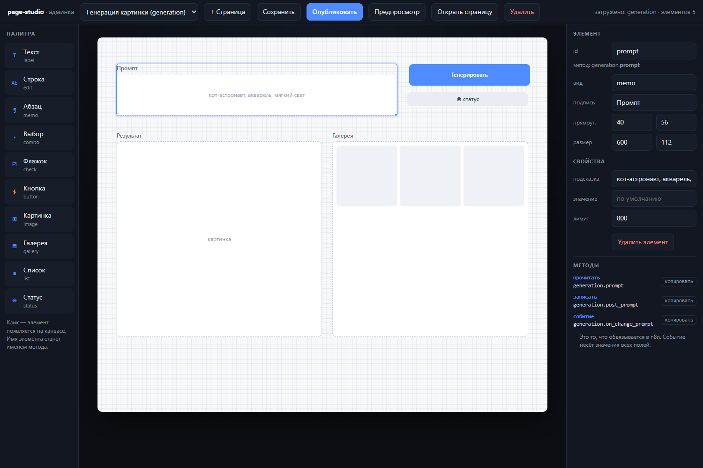

# page-studio

Портал-конструктор: страница собирается из элементов мышью, а логика живёт снаружи —
в любом бэкенде, который умеет принимать HTTP. Каждый элемент — это метод:
чтение, событие, запись. Портал не знает, что за ним: генератор картинок, очередь,
база или скрипт. Он хранит состояние и показывает то, что в него положили.

Сейчас в примерах — n8n и ComfyUI, но это только пример. Подойдёт FastAPI,
Go-сервис, PHP, Make, cron с curl: контракт от инструмента не зависит.

[](https://github.com/configuration23/page-studio/actions/workflows/ci.yml)
[](LICENSE)



## Зачем

Каждый пет-проект упирается в одно и то же: логика уже есть — в n8n, в скрипте, в
сервисе, — но показать человеку поле, кнопку и картинку нечем. Здесь страница
собирается за минуты, а обвязка — один вебхук в сторону бэкенда.

Элемент `prompt` на странице `generation` сразу даёт три метода:

| Метод | Направление |
|---|---|
| `generation.prompt` | бэкенд читает значение |
| `generation.post_image` | бэкенд записывает картинку |
| `generation.on_click_push` | браузер → бэкенд, со снимком формы |

## Быстрый старт

```bash
cp .env.example .env      # PORTAL_TOKEN и ADMIN_PASSWORD обязательны
pnpm install && pnpm build
pnpm start                # http://127.0.0.1:3000
pnpm demo                 # «бэкенд» на время: событие → статус → картинка
```

Docker (целевая среда — Linux):

```bash
docker compose -f docker/compose.example.yaml up -d --build
```

## Что внутри

- 10 видов элементов: текст, строка, абзац, выбор, флажок, кнопка, картинка,
  галерея, список, статус;
- дизайнер `/admin`: палитра, канвас 960 px, инспектор, перетаскивание, отмена;
- черновик → публикация → предпросмотр; правка не меняет живую страницу;
- переименование элемента не рвёт обвязку: старое имя остаётся алиасом;
- состояние по сессиям на сервере, живые обновления через SSE;
- картинки хранятся у портала и живут в галерее;
- демо-драйвер вместо бэкенда — эталон контракта.

## Доступ

| Кто | Как |
|---|---|
| Админ (`/admin`, предпросмотр черновика) | вход по логину и паролю (`ADMIN_USER` / `ADMIN_PASSWORD`), сессия в куке на 7 дней |
| Бэкенд (запись значений) | `Authorization: Bearer <PORTAL_TOKEN>` |
| Пользователь | без входа; наружу — только через nginx с TLS |

Без `ADMIN_PASSWORD` админка выключена (503), а не открыта всем. Для скриптов и curl
остался HTTP Basic теми же логином и паролем.

## Проверки

```bash
pnpm typecheck   # типы
pnpm build       # сборка
pnpm test        # 20 юнит-проверок
pnpm smoke       # 17 сквозных: событие → статус → картинка
```

CI — [`.github/workflows/ci.yml`](.github/workflows/ci.yml): типы, сборка, тесты.

## Документация

| Документ | О чём |
|---|---|
| [ARCHITECTURE](docs/ARCHITECTURE.md) | модель, методы, API, хранилище |
| [BACKEND](docs/BACKEND.md) | как подключить любой бэкенд, пример на n8n |
| [OPERATIONS](docs/OPERATIONS.md) | установка, бэкап, обновление, откат |
| [DECISIONS](docs/DECISIONS.md) | почему сделано так (ADR) |
| [BACKLOG](docs/BACKLOG.md) | отложенное и открытые решения |
| [VISION](docs/VISION.md) | зачем, границы, критерии успеха |
| [CHANGELOG](CHANGELOG.md) | что менялось |
| [SECURITY](SECURITY.md) | модель защиты и как сообщить об уязвимости |

## Лицензия

MIT — см. [LICENSE](LICENSE).
